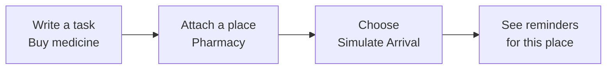

<div align="center">

# Oh, Wait!

### Remember it when it matters.

An everyday reminder assistant that connects **what you need to do** with **where you need to do it**.

**Buy medicine → Pharmacy** &nbsp;·&nbsp; **Return a book → Library** &nbsp;·&nbsp; **Pick up a parcel → Post office**

Built with React, TypeScript, Vite, and Lucide React · Local-first · Installable PWA

</div>

---

Most to-do lists keep a task in an inbox and hope you remember it later. **Oh, Wait! gives every reminder a destination.** When you choose to simulate arriving at a saved place, it brings forward only the active reminders that belong there.



## The idea, in practice

1. **Save a place** you visit, such as a pharmacy, grocery store, library, or somewhere of your own.
2. **Add a reminder** and choose the place where it should come to mind. A due date, note, and repeat schedule are optional.
3. **Simulate arrival** at that saved place to see its eligible reminders. Complete a task or snooze it right from the arrival check.

The arrival step is an explicit prototype interaction. **Oh, Wait! does not track your location or detect real-world arrivals.**

## What you can do

- **Keep tasks tied to destinations** — create, edit, complete, snooze, and delete reminders; search and filter by task or place.
- **Make places your own** — add, edit, favorite, and remove destinations. See the reminders linked to each place.
- **Check in on your terms** — simulate arrival at one place and see only its active, due, unsnoozed reminders. A 15-second per-place cooldown prevents rapid repeat clicks from adding duplicate arrival activity.
- **Choose when to be reminded** — set a due date, snooze for 30 minutes or 1 hour, and create daily, weekly, or monthly reminders.
- **Keep a useful history** — review reminder, place, and simulated-arrival activity. Undo recent deletions.
- **Take your data with you** — export or restore a full JSON backup, or export reminders as CSV.
- **Use it on the go** — install it where the browser supports web apps. After a successful first visit, the cached app shell can reopen offline.

## Privacy by design

Reminders, places, and activity are stored in this browser's `localStorage`. The app does not require an account, use a backend, or send reminder data to a server. Clearing app data removes Oh, Wait!'s own saved records without clearing unrelated browser storage.

The prototype does **not** request location permission, discover nearby places, run background geofencing, or send native push notifications. Simulated arrival is always started by the user.

## Run it locally

You'll need Node.js and npm installed.

```sh
git clone https://github.com/gayathrisanthoshpc/oh-wait.git
cd oh-wait
npm install
npm run dev
```

Vite prints the local development URL in the terminal. To create and serve a production build locally:

```sh
npm run build
npm run preview
```

The production files are written to `dist/`. The project can be deployed to Vercel or another static host; no backend or environment secrets are required.

## Checks

```sh
npm run lint
npm run build
npm test
```

`npm test` builds the app and runs the browser smoke suite in headless Chrome or Edge. It covers the main reminder and place flows, persistence across reloads, arrival filtering, snoozing, repeating reminders, deletion undo, favorites, backup restore, CSV export, keyboard access, mobile sizing, unrelated localStorage preservation, and offline app-shell reopening.

## How the code is organized

| Path | Responsibility |
| --- | --- |
| `src/App.tsx` | Navigation, page composition, reminder and place actions, and dialogs |
| `src/components/ReminderRow.tsx` | Shared reminder display and task actions |
| `src/components/Dialog.tsx` | Keyboard-accessible modal behavior and focus handling |
| `src/hooks/useOhWaitData.ts` | Local persistence and reminder, place, and activity updates |
| `src/lib/model.ts` | Data types, validation, defaults, and backup parsing |
| `src/polish.css` | Visual tokens, place markers, and responsive refinements |
| `public/service-worker.js` | Production app-shell caching for offline reopening |
| `scripts/smoke.mjs` | Isolated browser workflow and regression checks |

Stored app data uses schema version `1` under the `oh-wait:data:v1` localStorage key. No migration or account setup is needed for normal use.

---

Made for the moment you reach the right place and remember the thing you came to do.
